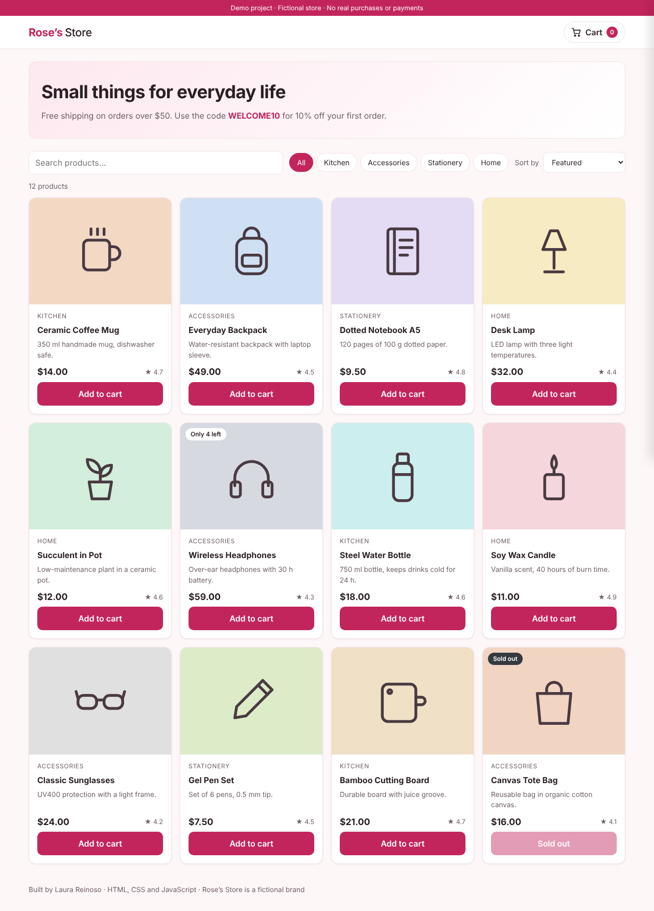
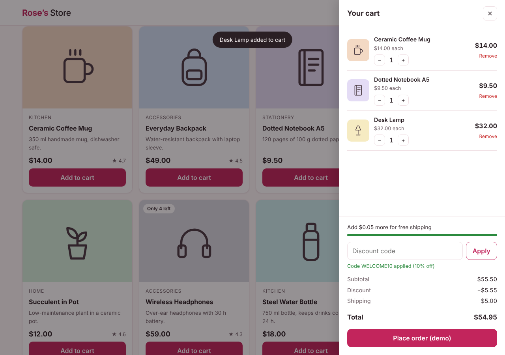

# Rose's Store — Shopping Cart

A responsive online store demo with product search, category filters, sorting and a complete shopping cart: quantities, stock limits, a discount code, free-shipping progress and a simulated checkout. Built with vanilla JavaScript, without frameworks or libraries.

**Live demo:** https://lauravanessa-r.github.io/shop-cart/

> Rose's Store is a fictional brand. This is a portfolio project: no real products are sold and no payment information is requested.



## Features

**Catalog**
- 12 products with category, description, price, rating and stock.
- **Real-time search** by name, description or category.
- **Category filters** and **sorting** by featured, price, name or rating.
- Stock badges ("Only 4 left", "Sold out") and disabled buttons when a product is unavailable.

**Cart**
- Side drawer with **+ / − quantity controls** and a remove option.
- **Stock validation:** you cannot add more units than are available.
- **Discount code:** `WELCOME10` gives 10% off; invalid codes show an error message.
- **Free shipping** from $50 (after discount), with a progress bar showing how much is missing. Otherwise, shipping costs $5.
- Subtotal, discount, shipping and total calculated automatically.
- The cart is **saved in the browser**, so it is kept after reloading the page.
- **Simulated checkout** that shows an order number and reduces the stock in the catalog.

**Interface and accessibility**
- Responsive layout for mobile, tablet and desktop, with automatic light/dark mode.
- The cart closes with the `Esc` key or by clicking outside it.
- Keyboard focus is handled when opening and closing the cart, and the closed cart cannot be reached with `Tab`.
- Notifications are announced to screen readers (`aria-live`), and animations are disabled for users who prefer reduced motion.



## Built with

- HTML5, CSS3 (Grid, Flexbox, custom properties) and vanilla JavaScript (ES6+)
- `localStorage` to save the cart
- Inline SVG icons for the product images (no external images)

## Project structure

```
shop-cart/
├── index.html          # Page layout: header, catalog, cart drawer and confirmation dialog
├── style.css           # Styles, light/dark theme and responsive design
├── js/
│   ├── products.js     # Product catalog and SVG icons
│   ├── cart.js         # Cart logic: add, update, remove, discount, totals and storage
│   └── app.js          # Interface: rendering, filters, events and checkout
└── assets/
    ├── screenshot-store.png
    └── screenshot-cart.png
```

The cart logic (`cart.js`) is separated from the interface (`app.js`), so the calculations can be read and tested on their own.

## How the totals are calculated

1. **Subtotal** = sum of price × quantity for each product.
2. **Discount** = subtotal × 10% when `WELCOME10` is applied.
3. **Shipping** = $0 if subtotal − discount ≥ $50, otherwise $5.
4. **Total** = subtotal − discount + shipping.

All amounts are rounded to two decimals to avoid floating-point errors (for example, `0.1 + 0.2` in JavaScript gives `0.30000000000000004`).

## Run it locally

Download or clone the repository and open `index.html` in your browser. No server or installation is needed.

```bash
git clone https://github.com/lauravanessa-r/shop-cart.git
```

## Possible improvements

- Product detail page with several images
- Wishlist
- Checkout form with field validation (name, address, email)
- Load the catalog from an API

## Author

**Laura Reinoso** — Statistician · Data Annotator · Front-end Developer
[LinkedIn](https://www.linkedin.com/in/laura-reinoso-a04321371) · [GitHub](https://github.com/lauravanessa-r)

## License

This project is licensed under the [MIT License](LICENSE).
